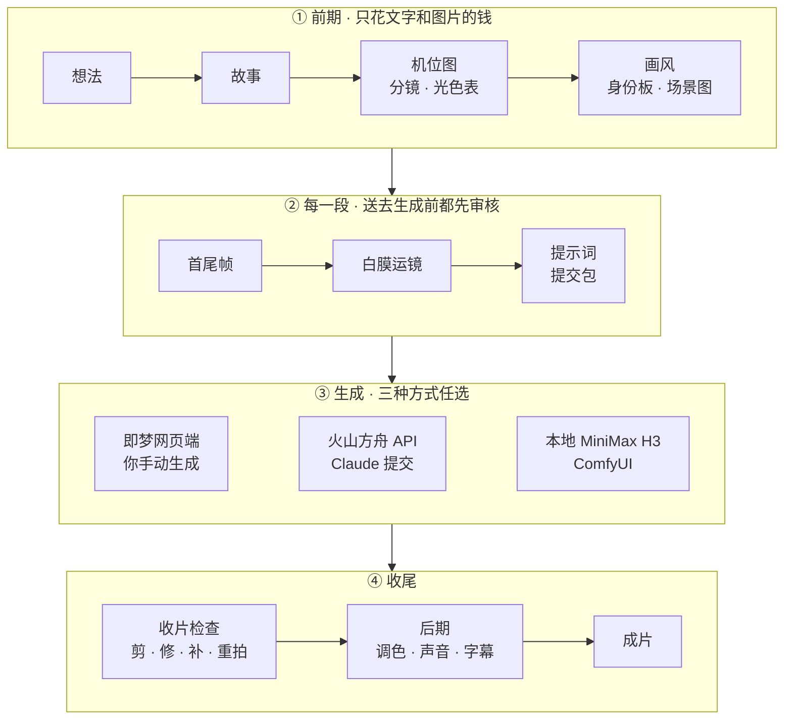
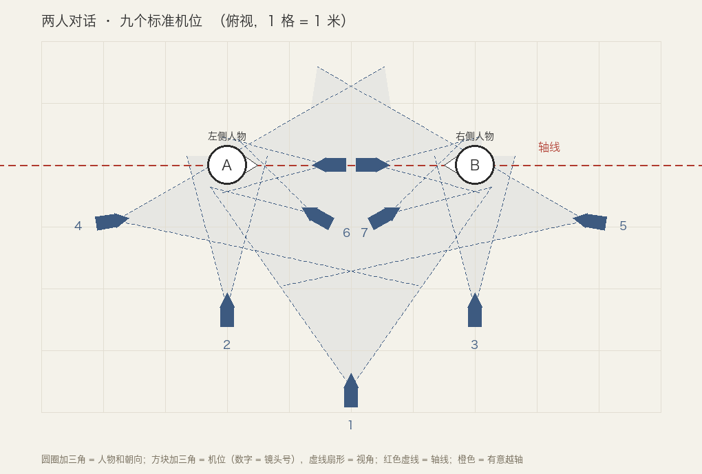

# AI Video Director

**让 Claude 当你的 AI 短片 / 短剧导演。** 你说出一个想法，Claude 带你走完故事、机位、分镜、画风、首尾帧、白膜运镜、视频提示词、收片检查和后期，最后交付成片。视频可以在即梦网页端手动生成，可以由 Claude 通过火山方舟 API 提交 Seedance，也可以用本地部署的 MiniMax H3。

*A Claude Code skill that directs AI short films end to end: story → blocking → keyframes → greybox camera reference → prompts for Seedance (Jimeng web or Volcengine Ark API) / MiniMax H3 → QC → ffmpeg post. Docs are in Chinese.*

这是一个 [Claude Code](https://claude.com/claude-code) skill：一套分阶段的工作流说明，加上 5 个小脚本。不需要写代码，全程和 Claude 对话即可。

> 核心原则：**错误越早发现越便宜。** 改文字几乎不花钱，重画一张图很便宜，重新生成一段视频最贵。文字里能发现的错不留到图上，图上能发现的错不留到视频上。每一段送去生成之前，都会先过一个新开的审核 agent。

---

## 它是怎么工作的



| 谁 | 做什么 |
|---|---|
| **你** | 定方向，确认故事、画风和光色；选择生成方式；看动态、听声音 |
| **Claude** | 写故事、分镜、光色表和所有提示词；审核每张图、每段视频；走方舟 API 时报价并提交；用 ffmpeg / Python 做后期 |
| **Codex** | 画样帧、角色身份板、场景图、首尾帧；写代码渲染白膜视频 |
| **视频模型** | Seedance（即梦网页端或火山方舟 API），或本地部署的 MiniMax H3 |

## 和"直接写提示词抽卡"有什么不同

- **白膜（greybox）运镜视频**：用灰色几何体和假人做一段运镜动画，作为参考视频交给模型，再配合首尾帧。推镜幅度、走位方向、动作时间、谁先谁后都由它确定，不靠文字描述去碰运气。所有白膜拼起来，还是一版能配乐检查节奏的动态分镜。
- **机位平面图**：每场戏画一张俯视机位图，自动检查是否越轴、两人左右有没有对调，并算出每个人在画面里的左右位置，直接写进提示词。
- **光色表**：每场戏锁定一套光（光源、方向、冷暖、色调），每段提示词原样复制同一句，几十段剪在一起才像一部片子。`look.py` 能找出颜色对不上的镜头，并给出校正参数。
- **短剧方法**：台词分"说 / 内心独白 / 画外音"三种写法，避免角色张嘴念心里话；对话戏多镜一段生成；用第一段的声音作为后面各段的参考，保持音色一致；准备反应镜头库，剪长台词时用。
- **层层审核**：故事、首尾帧、每段提交前、成片，各有一份审核任务书。审核 agent 只拿材料，不拿结论，像第一次看片的观众一样挑错。
- **出错先剪、再修、再补，最后才重拍**，旧版本一律保留。

<p align="center">
  <br>
  <sub><code>floorplan.py</code> 渲染的两人对话九机位图</sub>
</p>

## 快速开始

**1. 安装**

```bash
git clone https://github.com/Yed-13/ai-video-director-skill.git ~/.claude/skills/ai-video-director
```

以后更新：

```bash
git -C ~/.claude/skills/ai-video-director pull
```

**2. 准备环境**

| 需要 | 用途 |
|---|---|
| [Claude Code](https://claude.com/claude-code) | 导演 |
| [Codex CLI](https://github.com/openai/codex) | 画图、写白膜代码 |
| `ffmpeg` / `ffprobe` | 检查和后期（macOS：`brew install ffmpeg`） |
| Python 3.9+ | 脚本只用标准库；装了 Pillow 时机位图输出 PNG，否则输出 SVG |
| 视频模型（任选） | 即梦账号；或火山方舟账号 + API Key（环境变量 `ARK_API_KEY`）；或本地的 MiniMax H3 |

没有 Codex 也能用：让 Claude 写出图提示词，你用自己习惯的生图工具（即梦、GPT Image、Nano Banana 等）出图，把图片放进项目文件夹，后面的流程不变。

**3. 开工**

在 Claude Code 里说：

> 我想做一支 30 秒的 AI 短片：一个老人每天给流浪猫留一碗饭，有一天猫带来了一只小猫……

Claude 会先问片长、画幅、用哪种方式生成视频、要不要配乐和字幕、预算，然后从故事开始一步步带你做。

## 三种生成方式

每一段准备好后，Claude 都会先生成一个**提交包**，并让审核 agent 检查一遍：

```
shots/s03/pack/
  01_首帧.png  02_尾帧.png  03_参考图-1_身份板.png  04_白膜.mp4
  prompt.txt   README.txt        ← 上传顺序、参数、提示词
  ark_request.json               ← 只在走方舟 API 时生成
```

接下来三种方式都可以，同一部片子也可以混用：

| | 即梦网页端 | 火山方舟 API | 本地 MiniMax H3 |
|---|---|---|---|
| 谁来提交 | 你按 `README.txt` 手动上传、生成 | Claude 上传素材、报价，你同意后由它提交、轮询、下载 | 你（或 Claude）在自己的机器上跑 ComfyUI |
| 适合 | 想自己看着每次生成、用即梦积分 | 想全程只和 Claude 对话、不手动操作 | 有显卡，想低成本大量抽卡 |
| 费用 | 即梦积分 | 按秒计费，以控制台为准（mini 版 720p 约 0.5 元/秒） | 电费和时间 |
| 引用写法 | `@图片1`、`@视频1` | `图片1`、`视频1` | `<Picture 1>`、`<Video 1>`、`<Subject 1>` |
| 首尾帧 + 白膜 | 全能参考模式 | 全参考模式（首尾帧写进提示词） | Ref2VA（FL2VA 不接收视频） |
| 输出 | 4–15 秒，约 720p | 4–15 秒，480p / 720p（标准版可到 1080p） | 4–15 秒，24fps，短边 768，立体声 |

- **方舟 API**：素材要先上传到能公网访问的地址（如火山引擎 TOS）。Key 只从环境变量读，不会被打印。每次提交前都会报价，等你同意；欠费就停下，不会替你充值。
- **本地 H3：建议在自己电脑上用 ComfyUI 部署**。用 int8 / 4bit 量化权重加显存卸载，显卡要求可以降到 3060 一级（系统内存建议 64GB 以上）；再配 4 步加速 LoRA 抽卡，门槛比官方的多卡部署低得多。

生成完的视频放回 `shots/s03/takes/s03_take1.mp4`。Claude 抽帧检查，告诉你哪里能剪、能修、要补，还是要重拍。

## 脚本

都在 `scripts/` 下，在项目根目录运行。

| 脚本 | 做什么 | 示例 |
|---|---|---|
| `floorplan.py` | 俯视机位图、画面左右表、越轴和左右对调检查 | `floorplan.py blocking/公园.json` |
| `look.py` | 量亮度、反差、冷暖、色偏、主要颜色；比较镜头颜色并给校正参数；画色块条 | `look.py compare 基准.png takes/*.mp4` |
| `frames.py` | 首尾帧叠图找错位、黑白检查、手机尺寸预览、构图线、裁切和推镜裁切 | `frames.py onion first.png last.png` |
| `pack.py` | 按后端限制校验素材和提示词格式，生成编号提交包（方舟另生成请求 JSON 和报价） | `pack.py build shots/s03 --backend jimeng --duration 6` |
| `clip.py` | 收片检查：联系表、首尾帧相似度、亮度和色温漂移、结尾跳变、抽帧 | `clip.py inspect takes/s03_take1.mp4 --first first.png` |

<p align="center">
  <br>
  <sub><code>look.py swatch</code> 生成的光色表色块条</sub>
</p>

## 项目结构

```
SKILL.md                    总流程、硬规则、分工（Claude 每次都会读）
references/                 各阶段说明，进入对应阶段时才读
  01-story.md                 故事和剧本格式
  02-shotlist.md              分镜、切镜规则、生成段
  camera-blocking.md          机位与轴线、两人对话九机位
  light-color.md              光影与色彩、光色表、调色
  03-style-sheets.md          画风、身份板、场景图、道具图
  04-keyframes.md             首尾帧
  05-greybox.md               白膜运镜视频
  06-video-prompt.md          提示词母版、台词与声音、常见错误、提交包
  07-review-repair.md         收片检查与修复
  08-post.md                  后期、声音、字幕、交付
  review-briefs.md            四份审核任务书
  four-thread.md              可选：四个 agent 协作
  backends/                   即梦网页端、火山方舟 API、MiniMax H3
scripts/                    5 个脚本（只依赖 Python 标准库和 ffmpeg）
templates/                  机位图模板
```

想记录只属于自己机器的信息（主机名、模型文件路径、实测经验），写成 `references/backends/minimax-h3-local.md`，Claude 用 H3 时会先读它。文件名带 `-local` 的文件已在 `.gitignore` 里，不会被提交。

## 局限

- Claude 看不到视频的动态，也听不到声音：动作流畅度、节奏、口型和音色，需要你看过、听过才能确认，Claude 会明确告诉你哪些没有检查。
- `look.py` 的"等效色温"反映的是画面整体的冷暖倾向，适合比较同一场戏的镜头，不能当作光源的真实色温。
- 即梦界面和各模型的行为会更新，文档里的经验会随实践修订。

## 致谢

- 工作流方法：Eian（@EianLu）的文章《Claude code/Codex+Seedance AI视频：从一个想法到成片的全流程》
- 短剧写法、切镜规则、资产图规范、声音一致性和光影写法的部分思路：Miller（@TuyetloanP81840）的文章《用 Claude + H3 一个人拍 AI 短剧》
- 即梦 Seedance 的输入限制和 @ 引用语法：[dexhunter/seedance2-skill](https://github.com/dexhunter/seedance2-skill)（MIT）
- MiniMax H3 提示词格式：[MiniMax-AI/MiniMax-H3](https://github.com/MiniMax-AI/MiniMax-H3) 的 `h3-prompt-writing` 指南

## 许可证

[MIT](LICENSE)。使用 MiniMax H3、即梦 / 火山方舟等第三方模型和平台时，请同时遵守它们各自的许可和服务条款。
